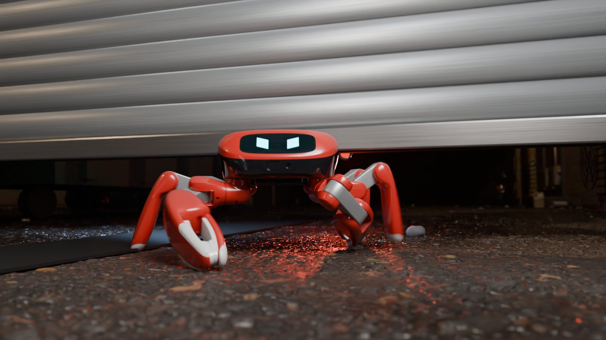
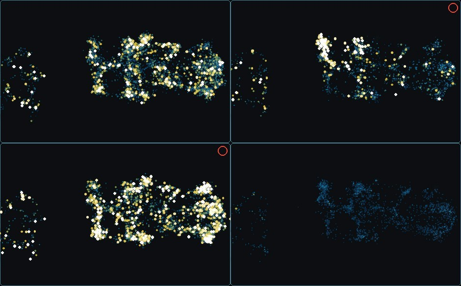
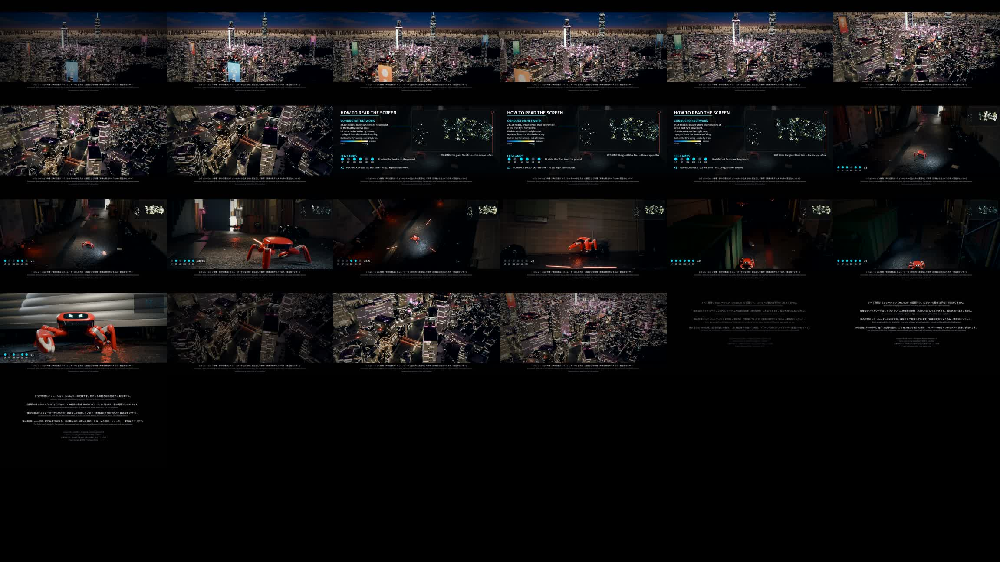

# Fly-Wired Crab

**A crab robot whose gaits are orchestrated by a network wired like a fruit fly's nerve cord (simulation).**

[日本語版 README](README.ja.md)

The robot is KingKong Robotics' **Jumper**, the open-source six-legged crab robot, simulated in MuJoCo. It is
controlled by a recurrent network that has the wiring of the fruit fly's ventral nerve cord: 24,154 neurons
from **MaleCNS v1.0**, with signed synapses. The network does not drive the joints. It acts as a conductor:
from the robot's own body signals, it decides at every step which of twelve frozen motor programs leads
(a softmax mix of them). When a leg dies or the floor turns slippery, it hands over to the right gait without being told
what went wrong. A separate escape reflex, hand-designed after the fly's giant-fibre pathway, steps aside,
ducks, jumps or raises a claw when something flies at the robot.

From one simulation recording we made a 38-second short film for Round 1 of the Crab Robot Challenge 2026.



**Film:** `jumper_round1_short_E_1080p.mp4` on the [release page](../../releases/tag/v1)
(1920×1080, 25 fps, 37.9 s). The same page has the trained weights.

## What is simulated, and what is not

| | |
|---|---|
| **The robot's motion** | Physics: MuJoCo (mujoco-warp on GPU), recorded at 200 Hz, replayed in Blender body by body. Nothing in the robot's motion is hand-animated. |
| **Sensing** | The escape reflex reads the projectiles' true position from the simulator: all round, no noise, no delay. The real Jumper has a forward RGB camera and a forward dToF only; on hardware this needs external tracking or added sensors, and any sensing latency comes out of a 0.3-0.45 s warning. |
| **"Bolts"** | 25 mm balls launched 1.8-3 m away that arrive in 0.45 s (4-7 m/s), drawn as laser bolts. |
| **Keyframed or placed by hand** | The drones (each one sits where its bolt is launched and is animated between launches), the roller shutter and the drone that hits it. The final weave is a commanded path, not a decision; the bins and the dumpster were placed afterwards where the robot swerved and were not in the simulation. |
| **"Fly brain"** | It is not one. The network uses the fly's nerve-cord wiring as its substrate. A control with the same network on **shuffled wiring performs as well** (+48.1% against +47.7%), so the gains come from the design (choosing among motor programs), not from the fly's wiring itself. |
| **Playback speed** | Parts are slowed (to x0.125) or sped up (x2); the HUD in the lower left always shows the factor. |

## The controller

```
 the robot's own sensors (the official policy's 415 observations)
   ├─ each leg's observations ───► that leg's sensory neurons (same fly leg nerve)
   └─ IMU, command, gait clock ──► haltere afferents, descending neurons
                      │
                      ▼
 fly ventral nerve cord: 24,154 nodes, 1.14 M signed synapses, one step per 5 ms
     s ← (1 − a)·s + a·tanh(g·(W s) + b + u)
                      │
                      ▼
 readout of the ascending + descending neurons ──► softmax over 12 motor programs
                      │
                      ▼
 frozen programs: official walk · dead front/rear leg · low grip · sprint ·
   dead RR, dead LM, slow dead LM (and mirrors) · official five-legged walk (and mirror)
                      │
                      ▼
 joint position targets (the programs' actions, mixed by the softmax)

 looming, read from the simulator ──► giant-fibre reflex: sidestep, duck, jump, claw guard
```

- **The cord.** MaleCNS v1.0 (Janelia FlyEM): the neurons of the thoracic nerve cord plus the descending
  (1,314) and ascending (1,846) neurons that link it to the brain, 24,154 nodes in all; synapses with at least
  5 contacts (1.14 M edges); signed by predicted neurotransmitter (acetylcholine excitatory, GABA and
  glutamate inhibitory). Each Jumper leg
  is wired to the fly leg in the same place: the pro-, meso- and metathoracic leg nerves, left and right.
- **The conductor ("director").** The cord does not move the joints itself. A readout of its ascending and
  descending neurons picks, every step, among twelve frozen motor programs. It is trained by distillation
  (DAgger) against labels that know the trouble — a dead leg, low grip — while the cord sees only the robot's
  own sensors, so it has to infer the trouble from how the body moves.
- **The escape reflex** is hand-designed after the fly's giant-fibre pathway (looming → DNp01 → jump): it fires
  when the time to contact gets short, latches a direction, and steps across the incoming lines, ducks 3 cm, jumps
  with the official jump policy, or raises the claw into a guard pose. Deflections are contact physics.



Full description: [docs/method.md](docs/method.md).

## Results (simulation, 64 robots per condition)

| | official policy | conductor + reflex (dgate6-s1, iteration 299) |
|---|---|---|
| Flat ground, speed ratio (walk / run / corner, mean) | 0.951 | 0.951 |
| 24 trouble conditions, mean speed ratio after the trouble | 0.485 | **0.717 (+47.7%)**, 19 better, 0 worse |
| Same recipe, second seed | | 0.717 (+47.6%), 20 better, 0 worse |
| **Control: same network, shuffled wiring** | | 0.719 (+48.1%), 19 better, 0 worse |
| Top speed on flat ground | 1.42 m/s | 1.59 m/s |
| Thrown balls that hit (from 1 m, six bearings, walking and running), at 0.3 / 0.4 / 0.6 / 0.9 s of flight | 1.00 / 1.00 / 1.00 / 1.00 | 0.49 / 0.00 / 0.00 / 0.00 |

Troubles: a dead leg (its torque limit set to zero; the policy still commands it) — LF, RF, LM, RR, LM+LR,
LM+RR — and foot friction dropped to 0.03 or 0.06, each striking at 2 s while walking (0.3 m/s), running
(0.6 m/s) or cornering (0.5 m/s, 1.5 rad/s). Speed ratio = mean forward speed after the trouble / command.
Every cell: [results/scoreboard-dgate6-299-gfmja.md](results/scoreboard-dgate6-299-gfmja.md); raw summaries
in [results/eval](results/eval).

Still weak: two dead legs on one side (LM+LR: 0.04-0.32, no better than the official), and the reflex against
the fastest throws (0.3 s of flight, about half still hit).

## How the film was made

One scripted run (`alley_parry`: a side bolt at 1.5 s, a frontal bolt parried at 3.2 s, a volley of three
ducked at 4.3 s, a wave of four jumped at 6.6 s, a hit on the left claw at 7.3 s that cuts the
leg's torque, after which the conductor switches to the five-legged gait, then the run), 24 robots side by side, take 21 used; the run after 7.4 s
was re-recorded with a weaving command from the same seed (take 21 within 1.4 cm of the original up to
7.4 s). Rendered in Blender 5.0.1 Cycles on Colab GPUs: a back-alley set dressed with CC0 scans, the drones
and bolts, and an aerial over a night Shinjuku built from PLATEAU 3D city models. Sound is synthesised from the
recorded events (footfalls, servo load, bolts, hits); no samples. Details: [docs/film.md](docs/film.md).



## Repository

| | |
|---|---|
| `experiments/vnc_v1/` | the cord model (`vnc_model.py`), the cord packet from MaleCNS (`build_packet.py`), the conductor's distillation (`distill_vnc.py`), the reflex (`escape.py`, `reflex_actor.py`, `tune_reflex.py`), the five-legged program (`five_foot.py`), evaluation (`eval_escape.py`, `scoreboard.py`), scene recording (`record_scene.py`) |
| `experiments/reflex_v1/` | the trouble events (`troubles.py`), the trouble evaluation (`eval_official.py`), the specialist fine-tunes (`train_mlp.py`) |
| `film/` | Blender scene scripts (`blender/`), post-production (`post/`), Colab render and cut scripts (`previz/`), the weave re-take (`sim/`) |
| `configs/` | the film brain's configuration |
| `results/` | scoreboards and evaluation summaries |
| `docs/` | [method](docs/method.md), [film](docs/film.md), [reproducing](docs/reproduce.md) |

## Credits and licences

- This repository's code: Apache-2.0 ([LICENSE](LICENSE)); third-party notices in [NOTICE](NOTICE).
- Jumper robot, its official policies and toolkit: KingKong Robotics, Apache-2.0
  ([KingKongRobotics/jumper](https://github.com/KingKongRobotics/jumper), commit `61d0652`).
- Nerve-cord wiring: **MaleCNS v1.0**, Janelia FlyEM, CC BY 4.0 — modified (subset, thresholded, signed,
  reordered). <https://male-cns.janelia.org/>
- City: **Project PLATEAU** 3D city models, Ministry of Land, Infrastructure, Transport and Tourism (Japan) —
  modified (signs in the photo textures blurred, night lighting, added street dressing).
- Props, textures and HDRI: **Poly Haven**, CC0.
- Fonts: Noto Sans JP, SIL Open Font License.
- Tools: MuJoCo and mujoco-warp, PyTorch, Blender, Google Colab. Code written with AI coding assistants
  (Claude Code, Codex) under the author's direction.
